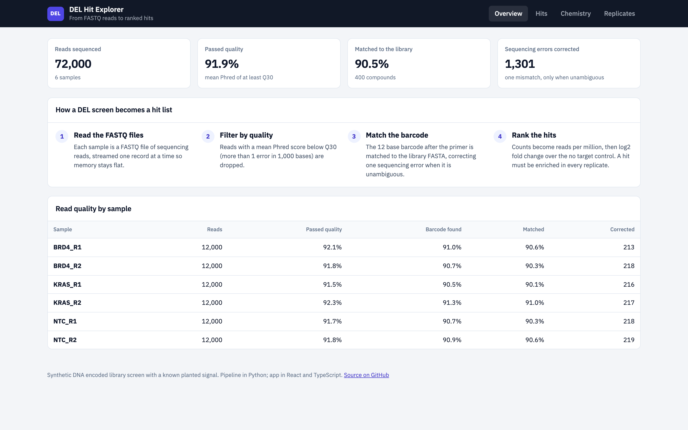
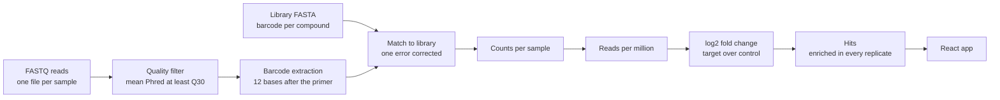
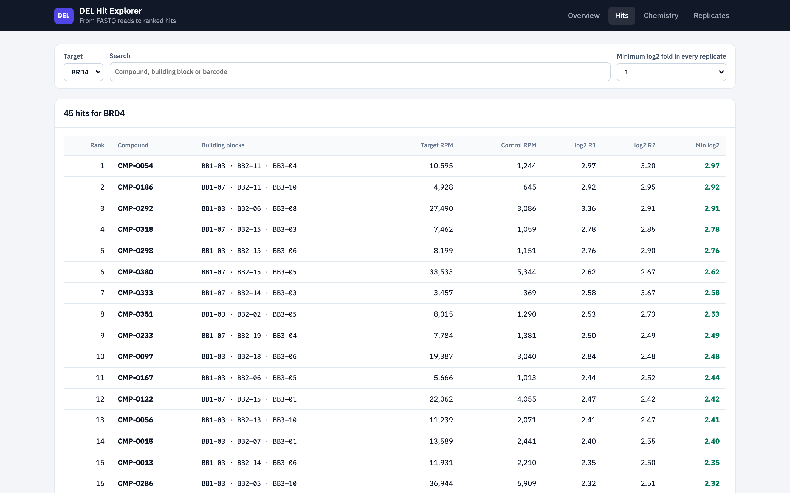
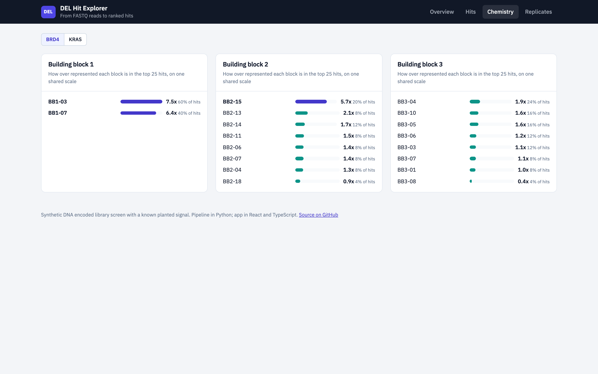
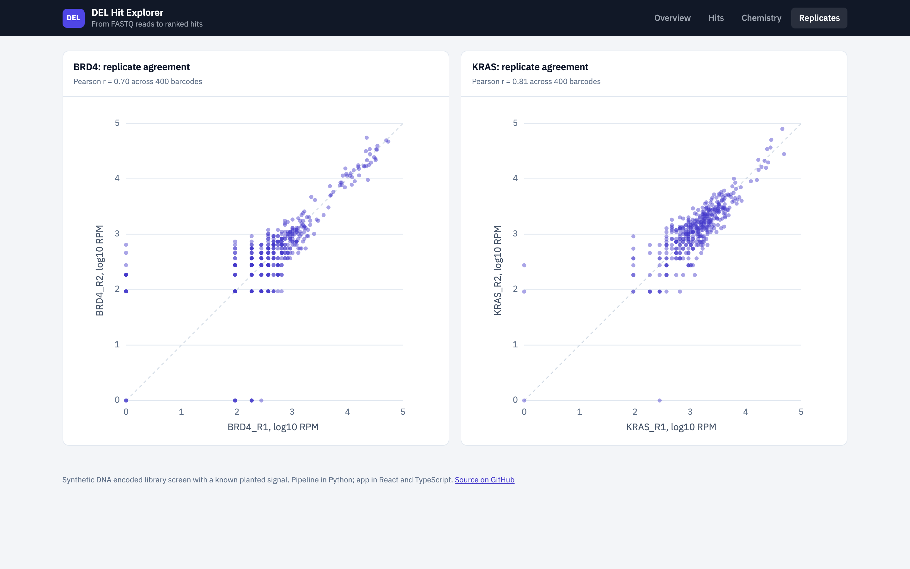

# DEL Hit Explorer

[](https://github.com/prasad0411/del-hit-explorer/actions/workflows/ci.yml)

**Live demo:** https://prasad0411.github.io/del-hit-explorer/

From raw sequencing reads to a ranked hit list for a **DNA encoded library (DEL)** screen. A Python pipeline streams **FASTQ** reads, filters them by quality, matches each read's barcode to the library **FASTA**, and computes enrichment against a no target control. A React and TypeScript app lets you explore the hits, the chemistry behind them, and how well replicates agree.



> The data is **synthetic**, because real DEL screens are proprietary. It is generated with a known answer: compounds built on BB1-03 or BB1-07 bind BRD4, and compounds built on BB2-11 bind KRAS. The pipeline recovers both without being told. Reads include sequencing errors, low quality reads and reads missing the primer, so every step has real work to do.

---

## How a DEL screen works, briefly

Every molecule in the library is built from three building blocks and carries a unique DNA barcode recording how it was made. The whole library is mixed with a protein target, molecules that do not bind are washed away, and the barcodes of the survivors are sequenced. A barcode that is much more common after the target selection than after a no target control marks a molecule that binds.

## The pipeline



| Step | What happens | Why |
|---|---|---|
| Read FASTQ | Each record is four lines: id, sequence, `+`, and a quality string with one character per base. Files are streamed, gzipped or plain, one record at a time. | Real runs produce gigabytes; memory stays flat. |
| Quality filter | Reads with a mean Phred score below Q30 are dropped. Phred is `ord(char) - 33`; Q30 means a 1 in 1,000 chance a base is wrong. | Bad reads create barcodes that do not exist. |
| Extract barcode | The 12 bases right after the primer `AGCTAG`. Reads without the primer are counted and skipped. | Locates the barcode regardless of the random prefix. |
| Match to library | Library barcodes come from a FASTA file. A read's barcode is matched exactly, or corrected if it is exactly one substitution away from a single library barcode. | Recovers reads with one sequencing error, without guessing when two barcodes are equally close. |
| Normalise | Reads per million (RPM) within each sample. | Samples are sequenced to different depths. |
| Enrich | `log2((target RPM + 1) / (control RPM + 1))` per replicate, against the mean of the control replicates. | The pseudocount avoids dividing by zero for barcodes absent from the control. |
| Rank | By the **minimum** fold across replicates, with a minimum signal of 50 RPM. | A real hit is enriched every time, not just on average. |

### The error correction, in one paragraph
Every library barcode is indexed together with all 36 of its one substitution neighbours (12 positions times 3 other bases) in a hash map, so matching a read is a single dictionary lookup rather than a comparison against every barcode. A neighbour shared by two library barcodes is ambiguous and removed from the index, so a read is only corrected when the answer is certain. The synthetic library keeps every pair of barcodes at least 3 substitutions apart, the same property real DEL barcode designs use to make single errors correctable.

## What the app shows

| View | Content |
|---|---|
| **Overview** | Reads sequenced, the share passing quality, the share matched to the library, errors corrected, and a quality table per sample |
| **Hits** | The ranked hits per target, searchable by compound, building block or barcode, filtered by the minimum fold in every replicate |
| **Chemistry** | Which building blocks are over represented in the top hits compared with the library, on one shared scale per target |
| **Replicates** | log10 RPM of replicate 1 against replicate 2 for every barcode, with the Pearson correlation |







## Results on the synthetic screen

| Check | Result |
|---|---|
| Reads | 72,000 across 6 samples (BRD4, KRAS and a no target control, 2 replicates each) |
| Passed quality | about 92% |
| Matched to the library | about 90%, including about 1,300 reads rescued by error correction |
| BRD4 chemistry | BB1-03 and BB1-07 lead the first building block position, as planted |
| KRAS chemistry | BB2-11 is about 14 times over represented in the top hits, as planted |
| Replicate agreement | Pearson r about 0.70 (BRD4) and 0.81 (KRAS) |

## Tech stack

| Layer | Tools |
|---|---|
| Pipeline | Python 3.13, pandas, NumPy; streaming FASTA and FASTQ parsers with gzip support |
| Frontend | React 19, TypeScript (strict), Vite; reusable components (a generic typed `DataTable`, an SVG scatter plot, bar lists) |
| Tests | pytest for the pipeline; Vitest and React Testing Library for the app |
| Delivery | Multistage Docker image (pipeline, then build, then an unprivileged nginx), GitHub Actions CI, GitHub Pages |

## Run it

```bash
# pipeline: generate the synthetic screen, then turn reads into hits
python -m venv .venv && .venv/bin/pip install -r requirements.txt pytest
.venv/bin/python -m delx synth data
.venv/bin/python -m delx run data/samples.csv data/library.fasta web/public/data
.venv/bin/python -m pytest -q

# app
cd web && npm ci && npm run dev
```

```bash
# or the whole thing in one container
docker build -t del-hit-explorer . && docker run -p 8080:8080 del-hit-explorer    # http://localhost:8080
```

## CI

Every push runs the pipeline tests and the pipeline itself, then lints, tests and builds the app, builds the Docker image and smoke tests it, and on `main` deploys the site to GitHub Pages using the data the pipeline just produced.

## Project layout

```
delx/          the pipeline: fastx.py (FASTA, FASTQ), barcodes.py (matching), pipeline.py, synth.py
data/          the synthetic screen: library.fasta, samples.csv, one FASTQ file per sample
tests/         pipeline tests, including an end to end run that must recover the planted binders
web/           the React and TypeScript app
Dockerfile     pipeline, then app build, then nginx
```

## Author

Prasad Kanade · [GitHub](https://github.com/prasad0411) · [LinkedIn](https://linkedin.com/in/prasad-kanade)
